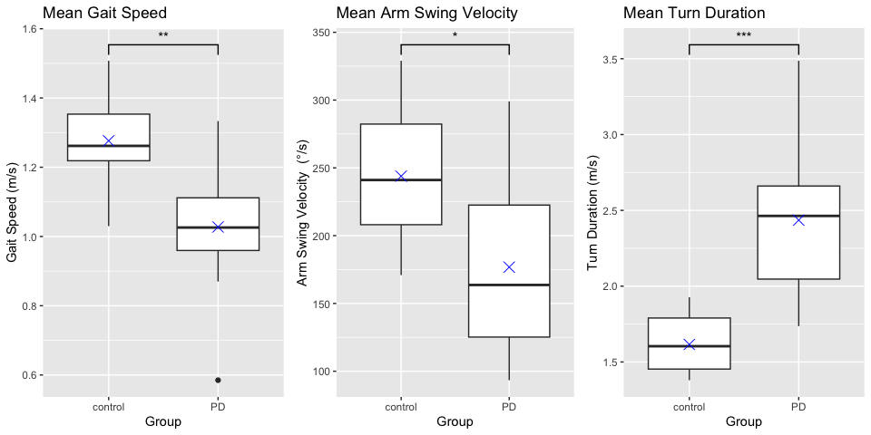
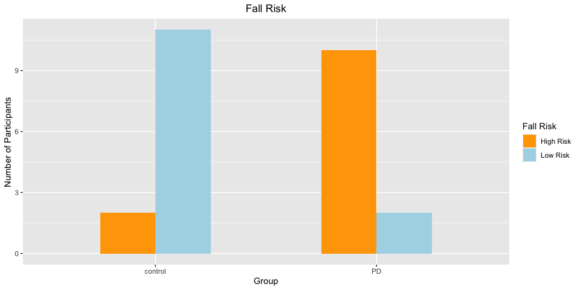

# Introduction & Literature Review

Parkinson’s disease (PD) affects an estimated one million individuals
(Kim et al., 2019). PD is caused by the progressive loss of dopaminergic
and cholinergic neurons in the substantia nigra of the basal nuclei,
causing symptoms such as bradykinesia (slowness of movement), freezing
of gait (FoG), muscle stiffness and gait disturbances (de Melo et
al.,2018;Gulcan et al.,2022). These symptoms can lead to increased fall
risk, significantly impact daily activity performance, independence, and
overall quality of life for people with Parkinson’s disease (PwP) (Kwon
et al., 2023; Gulcan et al., 2022).

Bradykinesia is a common symptom of PD. Specifically, reduced arm swing,
gait speed, and turn duration are common indicators of increased fall
risk (B H Wood et al., 2002; Kyrdalen et al., 20219; Manicini et al.,
2018). Individuals utilize arm swing to maintain stability, reduce
energy cost and initiate lower limb movement during gait (Meyns et al.,
2013). Wood et al.(2002) conducted a study with 109 PwP as either faller
(69 reported at least one fall during the one year follow up period) or
non faller (40). Baseline assessments took place over a six month period
in which individuals physical and mental functioning were assessed.
Additionally, gait and balance functionality was assessed by a
physiotherapist through sit to stand tasks and walking over 10 meters.
Results showed a significant association between loss of arm swing and
falling (67.3% of fallers and 33.3% of non fallers p = 0.003). The
researchers concluded that loss of arm swing was an independent
predictor of fall risk. Navarro-Lopez et al. (2022) conducted a
systematic literature and meta-analysis of four studies that compared
arm swing velocity of PwP and control participants while walking.
Results showed that PwP had 0.31 m/s slower arm swing compared to
control participants.

Gait speed is a common measure of mobility in clinical settings as is
considered a “vital” sign of functional mobility and health as it can
indicate less dynamic stability (Mehmet et al., 2020). Gait speed is a
product of steps per minute (cadence), and stride length. A review by
(Creaby & Cole, 2018) found lower cadence and shorter strides increases
fall risk in PwP. Hyrdalen et al. (2019) conduced a study with 108 older
adults. All participants walked over a distance of 4 meters at their
preferred gait speed. The cutoff gait speed was 1.0 m/s. The mean gait
speed was 1.00 ± 0.26 m/s and 48 (44.4%) of the individuals were below
1.0 m/s, which indicated increased fall risk.

Unlike straight-ahead walking, turning during gait requires an
individual to adjust their locomotor system to maintain stability and
turn safely. Turning becomes more challenging with age and older adults
typically exhibit slower turn duration and greater step width as a
precaution strategy (Mancini et al., 2018)

In the study by Mancini et al. (2018), 35 older adults were grouped
based on their number of falls in the past 12 months. Nonfallers (NF, N
= 16) had no falls, single fallers (SF, N = 12) had one fall, and
recurrent fallers (RF, N = 7) had more than one fall in the past 12
months. Each participant wore wearable sensors to monitor their movement
over seven days. Results showed that the RF group had significantly
longer mean turn duration (SF = 3.3, p = .05; RF compared with NF p=
0.01) and significantly larger number of steps per turn compared to SF
and NF (SF = 5.2, p = 0.01; RF compared with NF p =.004; RF compared
with SF p = .01).

Similar to Mancini et al. (2018), researchers in recent years have used
synchronized, wearable inertial sensors such as Ambulatory Parkinson’s
Disease Monitoring (APDM) Opal sensors as a way to quantify gait and
balance characteristics during clinical tasks.

The purpose of this project is to characterize PwP and control
participants from this study as high fall risk or low fall risk based on
the variables mentioned above during the Instrumented Stand and Walk
(ISAW) test.

The research questions are as follows:

1.  Is there a significant difference in the proportion of people with
    Parkinson’s disease classified as increased fall risk compared to
    control participants?

2.  Are there significant differences in arm swing velocity, turn
    duration, and gait speed in people with PD compared to control
    participants?

# Methods and Sample

13 PwP and 12 older adults (controls) participated in this study. No
participants had other orthopedic surgery, and were able to walk
independently. The Hoehn and Yahr (H&Y) scale is used to describe the
progression of PD and functional disability. Stage I indicates PwP have
unilateral involvement only, usually with minimal or no functional
impairment. In Stage V, PwP have confinement to bed or wheelchair unless
aided. All PwP in this study were within H&Y I-III.

For this study,all participants were fitted with six APDM Opal sensors
(Portland,OR) worn on both wrists, feet, lumbar, and sternum. The data
from the sensors was recorded and synchronized at 128 Hz and stored in
the Opal’s memory system. Each participant completed the Instrumented
Stand and Walk (ISAW) test which is a test through the APDM Mobility Lab
software platform. For this test, participants stand still for 30
seconds with hands on their hips and eyes open, then they walk at a
comfortable pace over 7 meters, turn 180 degrees, walk back, and stand
still at the starting position. This test was repeated on average 3±1
depending on technical issues faced during data collection.

The data from the sensors was streamed wirelessly to a computer. After
each test, APDM Mobility Lab automatically calculates outcome
measures.The data for each participant was downloaded as a CSV for
analysis.

First, for the cleaning process the numeric variables of interest were
renamed and assigned to a new variable. There was no missing data in the
outcome variables.Since the original CSV had arm swing and gait speed
for the left and right sides of the body separately, the average was
taken for each of these variables to get a single value for arm swing
velocity and gait speed,respectfully. A new column “group” was created
to indicate TMOA as control and TMPD as PD. This grouping was used
throughout the rest of the analysis. The dataframe was organized by
group and in numerical order.

For the categorical variables the cleaning process was as follows. Only
TMOA and TMPD participants were extracted from the dataset. TMOA10, and
TMOA12 were excluded because they did not have numeric data.
Additionally TMOA7female was removed because it was a duplicate of
TMOA7. A new column “group” was created to indicate TMOA as control and
TMPD as PD which was used throughout the rest of the analysis. The
dataframe was organized by group and in numerical order.

The first graphical technique was a boxplot. The lines that extend out
from the box (whiskers) indicate the minimum and maximum values. The
middle line inside the box is the middle point of the data (median) also
known as the second quartile (Q2). The first quartile (Q1) is the median
of the bottom half of the data. The third quartile (Q3) is the median of
the upper half of the data. The box represents the middle 50% of the
data i.e. Q3-Q1 (interquartile range). Outliers are potted with a
circle. A median that is closer to the bottom or top of the plot
indicated more skewed data. An X was added to indicate the position of
the mean.

The second graphical technique was a barplot. A barplot displays the
frequency of categories with adjacent bars. The height of the bar
represents the value for each category. In this project, the barplot was
used to indicate the number of participants in each group (control or
PD) as either low or high fall risk.

Below is a table of descriptive statistics. Numeric variables are
presented as mean ± SD and categorical variables are presented as
frequencies and percentages.

<table class=" lightable-classic" style="font-family: &quot;Arial Narrow&quot;, &quot;Source Sans Pro&quot;, sans-serif; margin-left: auto; margin-right: auto;border-bottom: 0;">
<caption>

**Table 1**

*Demographics and Outcome Variables*
</caption>
<thead>
<tr>
<th style="text-align:left;">
</th>
<th style="text-align:center;">
Overall (n = 25)
</th>
<th style="text-align:center;">
Control (n = 13)
</th>
<th style="text-align:center;">
PD (n = 12)
</th>
</tr>
</thead>
<tbody>
<tr>
<td style="text-align:left;">
**Age**
</td>
<td style="text-align:center;">
62.80 (8.06)
</td>
<td style="text-align:center;">
59.31 (7.36)
</td>
<td style="text-align:center;">
66.58 (7.24)
</td>
</tr>
<tr grouplength="5">
<td colspan="4" style="border-bottom: 0;">
<strong>Race</strong>
</td>
</tr>
<tr>
<td style="text-align:left;padding-left: 2em;" indentlevel="1">
Asian
</td>
<td style="text-align:center;">
3 (12.0%)
</td>
<td style="text-align:center;">
1 (7.7%)
</td>
<td style="text-align:center;">
2 (16.7%)
</td>
</tr>
<tr>
<td style="text-align:left;padding-left: 2em;" indentlevel="1">
Black or African American
</td>
<td style="text-align:center;">
1 (4.0%)
</td>
<td style="text-align:center;">
0
</td>
<td style="text-align:center;">
1 (8.3%)
</td>
</tr>
<tr>
<td style="text-align:left;padding-left: 2em;" indentlevel="1">
White
</td>
<td style="text-align:center;">
16 (64.0%)
</td>
<td style="text-align:center;">
7 (53.8%)
</td>
<td style="text-align:center;">
9 (75.0%)
</td>
</tr>
<tr>
<td style="text-align:left;padding-left: 2em;" indentlevel="1">
More Than One Race
</td>
<td style="text-align:center;">
2 (8.0%)
</td>
<td style="text-align:center;">
2 (15.4%)
</td>
<td style="text-align:center;">
0
</td>
</tr>
<tr>
<td style="text-align:left;padding-left: 2em;" indentlevel="1">
Unknown/Not Reported
</td>
<td style="text-align:center;">
3 (12.0%)
</td>
<td style="text-align:center;">
3 (23.1%)
</td>
<td style="text-align:center;">
0
</td>
</tr>
<tr grouplength="2">
<td colspan="4" style="border-bottom: 0;">
<strong>Gender</strong>
</td>
</tr>
<tr>
<td style="text-align:left;padding-left: 2em;" indentlevel="1">
Female
</td>
<td style="text-align:center;">
12 (48.0%)
</td>
<td style="text-align:center;">
9 (69.2%)
</td>
<td style="text-align:center;">
3 (25.0%)
</td>
</tr>
<tr>
<td style="text-align:left;padding-left: 2em;" indentlevel="1">
Male
</td>
<td style="text-align:center;">
13 (52.0%)
</td>
<td style="text-align:center;">
4 (30.8%)
</td>
<td style="text-align:center;">
9 (75.0%)
</td>
</tr>
<tr grouplength="3">
<td colspan="4" style="border-bottom: 0;">
<strong>Outcome Variables</strong>
</td>
</tr>
<tr>
<td style="text-align:left;padding-left: 2em;" indentlevel="1">
Gait Speed, m/s
</td>
<td style="text-align:center;">
1.16 (0.21)
</td>
<td style="text-align:center;">
1.28 (0.13)
</td>
<td style="text-align:center;">
1.03 (0.19)
</td>
</tr>
<tr>
<td style="text-align:left;padding-left: 2em;" indentlevel="1">
Arm Swing Velocity, °/s
</td>
<td style="text-align:center;">
211.67 (69.16)
</td>
<td style="text-align:center;">
243.87 (51.57)
</td>
<td style="text-align:center;">
176.78 (70.59)
</td>
</tr>
<tr>
<td style="text-align:left;padding-left: 2em;" indentlevel="1">
Turn Duration, s
</td>
<td style="text-align:center;">
2.01 (0.55)
</td>
<td style="text-align:center;">
1.62 (0.19)
</td>
<td style="text-align:center;">
2.44 (0.50)
</td>
</tr>
</tbody>
<tfoot>
<tr>
<td style="padding: 0; " colspan="100%">
Note: 
</td>
</tr>
<tr>
<td style="padding: 0; " colspan="100%">
 PD = Parkinson’s disease. All PD participants were bewteen
Hoehn and Yahr stage I-III out of V with higher stage indicating
increased disease serverity
</td>
</tr>
</tfoot>
</table>

# Findings

Since there was a small sample size (N=25), a two sided t-test was used
and it was assumed that variances are not equal.

<!-- -->
**Figure 1** displays boxplots for each outcome variable across control
and PD participants. A blue X indicates the mean for each variable per
group \* p\<0.05, \*\* p\<0.01,\*\*\* p \<0.001

Gait speed p-value: 0.001

Arm swing velocity p-value: 0.014

Turn duration p value: 0.0001

Based on the findings, arm swing velocity had the most variability
especially among the PD group. Additionally, the data is more skewed for
the PD group with turn duration as indicated by the high median line.
There was one outlier as shown by the circle in the gait speed plot. As
indicated by the location of the mean compared to the median, many
variables are relatively symmetrically distributed for both groups with
the acceptation of arm swing velocity for the PD group.

In order to categorize each participant as “High Fall Risk” or “Low Fall
Risk”, several thresholds were created. As previously mentioned, a gait
speed at or below 1.0 m/s indicates increased fall risk. For arm
velocity, if a participant was at or below the minimum arm swing
velocity of the control group they were considered high fall risk.
Lastly if a participant had a turn duration at the max turn duration of
the control group or higher, then they were classified as high fall
risk.

<!-- -->
**Figure 2** displays fall risk level for each group

# Discussion

As shown in the literature, wearable sensors are a powerful tool for
quantifying gait and balance variables. This study utilized APDM Opal
sensors to analyze these variables in PwP and control participants.The
results showed that there is a significant difference in the proportion
of PwP classified as high fall risk compared to control
participants.Specifically, 83.3% of the PwP were classified as “High
Risk” compared to only 15.4% of controls. Additionally, there were
statistically significant differences in each outcome variable across
groups with Turn Duration showing the highest amount of significant
difference (p \<0.001). A limitation of this research paper is the small
sample size and lack of mixed effects model. Since the measures were
repeated for each participant, this analysis technique would have
accounted for the repeated measures and make the statistical analysis
more powerful. The outcome variables analyzed in this study are not the
only ones that can indicate increased fall risk, which creates an
additional limitation to this study. Adding more variables such as steps
in turn, and turn angle could provide a more comprehensive understanding
of fall risk. Future research could benefit from applying this technique
to evaluate performance before and after interventions, helping to
inform the development and improvement of targeted strategies aimed at
improving performance and reducing fall risk especially for PwP.
